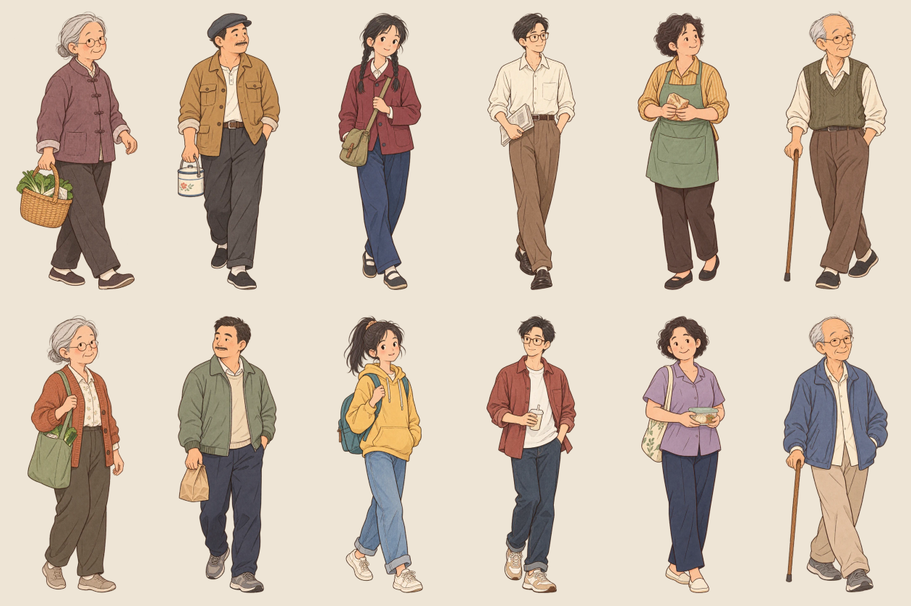

# v13 · 街坊行人扩充

2026-10-05，本地版本，未推送或发布。

街上原有 18 个行人实例，但每个时代只轮流使用两张人物图，路线里的 `image` 配置没有参与选图。现在让路线实际选取人物，并新增六组今昔人物：买菜婆婆、提饭工人、背包学生、眼镜青年、端早饭的邻居与拄杖街坊。每个时代共有八种人物，脸型、发型、体型、身高、装束、姿态与随身物品均有区别。

黎明首先出现的四位使用四种不同人物；18 位中每种复用两到三次，同款在初始街道位置分散。五分钟的早市时间、逐渐从四位增至十八位的到场节奏、行走速度和路线继续沿用原版。

人物图按原始比例生成纸片轮廓，并分别校准身高和脚底位置。碰撞半径取今昔两套实际轮廓的较大值，篮子、背包和手杖同样参与避让。今昔切换仍沿用纸片翻转，显示对应时代的装束。

## 素材与主要文件

- 内置 `image_gen` 生成六张双人物透明 PNG，保留原稿于 [art/pedestrians-v13](art/pedestrians-v13)。完整提示词见 [prompts.md](art/pedestrians-v13/prompts.md)。人物为虚构插画。
- 十二张运行时透明 WebP 位于 `public/assets/storybook/pedestrian-*-v13.webp`，高度 896 像素，总计 864,400 字节。原图未被覆盖。
- [manifest.json](art/pedestrians-v13/manifest.json) 记录原图 SHA-256、透明分隔位置、裁切范围、尺寸与体积；[prepare-pedestrian-art.cjs](tools/prepare-pedestrian-art.cjs) 可复现转换。
- [pedestrianProfiles.ts](src/street/pedestrianProfiles.ts) 定义人物与两代素材；[MorningStreet.ts](src/street/MorningStreet.ts) 加载人物并绑定到原有行人路线。



## 当前验收

- `npm.cmd test`：65 项通过。首次沙箱运行遇到 Node 子进程 `spawn EPERM`，正常执行环境重跑通过。
- `npm.cmd run build`：类型检查和正式构建通过，102 个模块；保留既有 Three.js 分包体积提醒。
- [行人浏览器检查](../pedestrian-qa/after/verification.json)：两代各八种实际纹理，黎明四人各不相同，每种最多复用三次；初始人物轮廓间最小间隙 0.4778。桌面 1440×960 与手机尺寸 390×844 的两代画面均已检查，无浏览器错误。
- [完整清晨回归](../pedestrian-qa/morning/verification.json)：全部 81 对地点、所有故事章节和移动人群路线，共 185 段 / 27,766 步；摄像机与障碍最小间隙 0.000806，移动人物之间最小间隙 0.04128，无轮廓交叠。时间、人流、六家开张、今昔变化和卡片动画通过。
- [正式构建验收](../pedestrian-qa/production/verification.json)：实际点击到访六家店，六味食篮、下载、刷新恢复、三家新店今昔切换与开门时间、手机店铺卡片通过；未注入开发场景探针，无页面错误。

截图：[扩充前](../pedestrian-qa/before/02-past-street.png)、[扩充后昔日](../pedestrian-qa/after/02-past-street.png)、[扩充后今日](../pedestrian-qa/after/03-present-street.png)、[手机今日](../pedestrian-qa/after/04-present-mobile.png)。手机尺寸由浏览器模拟，实体手机性能尚未实测。

本地开发入口 `http://127.0.0.1:5190/`，正式构建预览 `http://127.0.0.1:5191/`。

```powershell
$env:SHARP_MODULE='C:/Users/zhudo/.cache/codex-runtimes/codex-primary-runtime/dependencies/node/node_modules/sharp'
node tools/prepare-pedestrian-art.cjs
$env:PLAYWRIGHT_MODULE='C:/Users/zhudo/.cache/codex-runtimes/codex-primary-runtime/dependencies/node/node_modules/playwright'
$env:CHROMIUM_PATH='C:/Users/zhudo/AppData/Local/ms-playwright/chromium-1223/chrome-win64/chrome.exe'
$env:VERIFY_OUT='../pedestrian-qa/after'
node tools/verify-pedestrians.cjs
```

## 2026-10-06：柜台内的固定站位修复

用户反馈豆皮铺内卡着一个路人。实际浏览器复现：粉色上衣挎包的 `pedestrian-14` 穿过豆皮铁盘，场景坐标为 x=5.6、z=2.5，且是 `moving:false` 的固定站位。同一镜头只隐藏该行人后，铁盘与摊主完整显示，排除柜台模型与贴图问题。检查全身轮廓还发现面窝 `pedestrian-15` 和汤包 `pedestrian-16` 的同类越界。

只修改 `MorningStreet.ts` 中三个站位：豆皮移到街侧角落 (4.1, 6.8)，面窝 (-4.1, -4.2)，汤包 (4.1, -23)。保留全部人物、数量、贴图、站立 / 行走设定；自由行走、避让、店铺模型与文化交流实现保持不动。

在 `tools/verify-pedestrians.cjs` 增加实际场景边界检查：使用两代人物最大的轮廓半径，加 0.08 间隙，检查全部 18 人的当前点和路径端点；包括黎明尚未出现的行人，避免进入店铺时突然出现。修复前稳定检出三人越界，修复后全部通过；八种人物样式、昔今与手机状态也通过。78 项测试与生产 build 通过。

复现证据与修复截图见相邻 `../culture-qa/doupi-pedestrian/`：`baseline.png`、`baseline-isolated.png`、`fixed.png`、`regression-before/verification.json`、`regression-after/verification.json`。场景探针只注入浏览器开发响应，没有加入产品源码。

生产预览另外实测 18 人早市的豆皮到访、文化入口、昔日 / 今日和窄屏画面，未注入场景探针，没有浏览器错误；结果与截图在 `production/`。本地构建已更新，未推送 GitHub。
